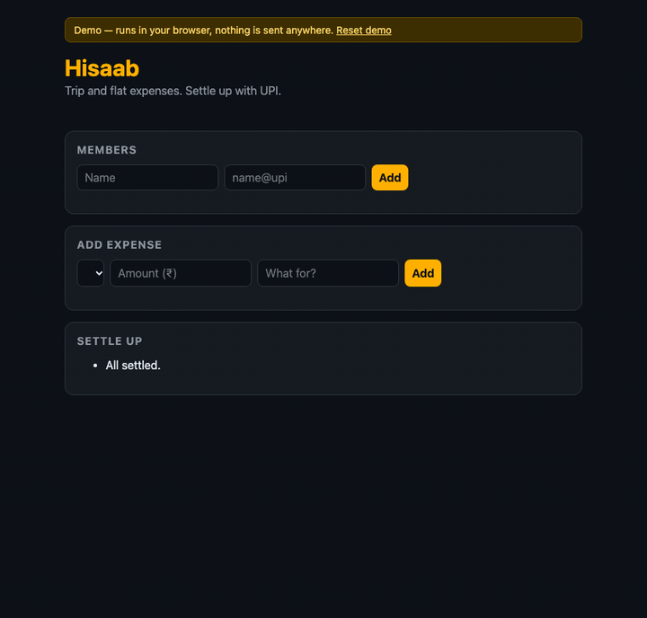
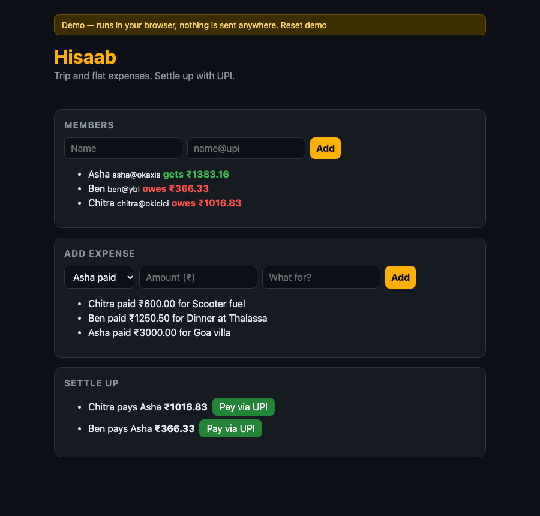
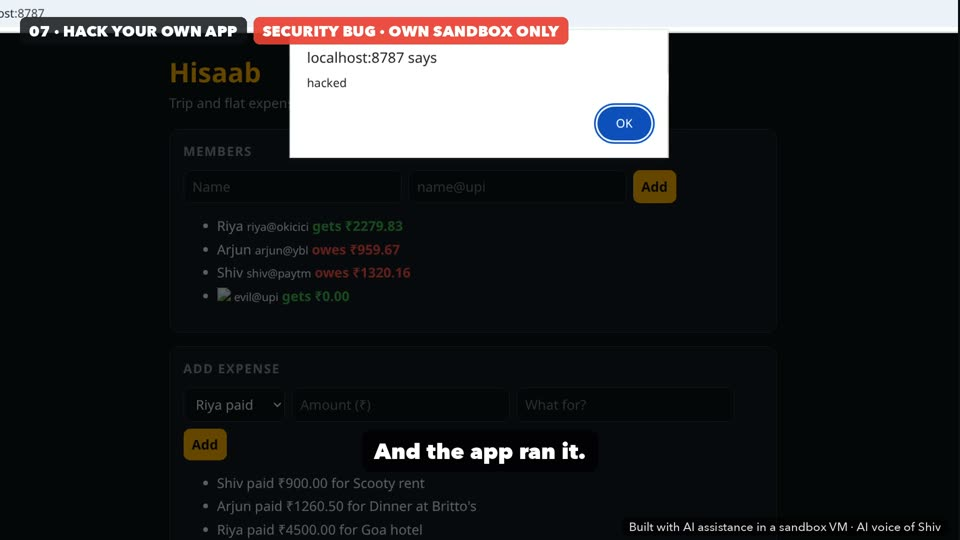

# Hisaab

**Split trip and flat expenses with friends, then settle up with UPI links.**
Built from scratch on camera in **Hackbig Builder Sessions, episode 1**: plan it, build it, break it, fix it.

[](https://codespaces.new/hackbighq/hisaab?quickstart=1)

- **Try it in your browser:** https://hackbighq.github.io/hisaab/ (a demo build: your data stays in your browser and nothing is sent anywhere)
- **Watch the build:** Hackbig on YouTube, Builder Sessions ep 1



## What it does

1. Add the people on the trip, each with a UPI id.
2. Add what each person paid. Every expense is split equally.
3. Hisaab shows who owes and who gets money back, and the fewest payments to settle everyone. Each payment
   has a **Pay via UPI** button (a `upi://pay` link that opens GPay, PhonePe, Paytm and other UPI apps on your phone).



Stack: a Cloudflare Worker + [Hono](https://hono.dev) + D1 (SQLite), one HTML page, Vitest. The whole app is about 300 lines.

## Run it

**In Codespaces (no setup):** click the badge above. It installs everything, creates a local database and starts the app;
the preview opens on port 8787. This uses your own free GitHub Codespaces hours.

**On your machine** (Node 20+):

```bash
git clone https://github.com/hackbighq/hisaab && cd hisaab
npm ci
npm run dev        # creates the local D1 database (answer "y" once), then serves http://localhost:8787
npm test           # money math, settle-up, input checks
npm run check      # TypeScript
npm run build:demo # the browser-only demo, in dist-demo/
```

Everything runs locally: `wrangler dev --local` simulates the Worker and D1 on your machine and needs no Cloudflare account.
The `database_id` in `wrangler.jsonc` is a placeholder.

## Follow along with the video

Each tag is the code exactly as it was at that point in the episode. Open a tag on GitHub, or `git checkout <tag>`.

| Video | Chapter | Code at that point |
|---|---|---|
| 0:00 | What we build | [`main`](https://github.com/hackbighq/hisaab) (finished app) |
| 0:35 | Plan first | [`ch1-plan`](https://github.com/hackbighq/hisaab/tree/ch1-plan): [PLAN.md](PLAN.md), one user story, pages, data, API |
| 1:35 | Scaffold | [`ch2-scaffold`](https://github.com/hackbighq/hisaab/tree/ch2-scaffold): Hono, Wrangler, Vitest, TypeScript |
| 2:29 | Database + money logic | [`ch3-db-money`](https://github.com/hackbighq/hisaab/tree/ch3-db-money): D1 schema, `splitEqual`, `settle`, `upiLink` + tests |
| 3:51 | API + page | [`ch4-api-page`](https://github.com/hackbighq/hisaab/tree/ch4-api-page): three API routes and the page |
| 5:34 | Run it | [`ch5-run`](https://github.com/hackbighq/hisaab/tree/ch5-run): local D1 migration, first real data |
| 6:32 | Fix what looks wrong | [`ch6-fix`](https://github.com/hackbighq/hisaab/tree/ch6-fix): "owes / gets" instead of negative rupees |
| 6:48 | Hack your own app | [`ch7-hack`](https://github.com/hackbighq/hisaab/tree/ch7-hack): the XSS bug and the `esc()` fix |
| 7:27 | Ship it | [`ch8-ship`](https://github.com/hackbighq/hisaab/tree/ch8-ship): tests + type check pass, dry-run build |

`ch2-scaffold` and `ch3-db-money` point at the same commit (the scaffold was committed together with the money logic),
and so do `ch4`/`ch5` and `ch6`/`ch7`. The commits after `ch8-ship` came after the video: a storage adapter so the same
logic also runs as the browser demo, input limits, a Content-Security-Policy, these docs and code comments.

## Bugs we hit on camera

**1. Cross-site scripting (XSS), 6:48.** The page builds its lists with `innerHTML`, and names come from users. Adding a
member named `` made the app run that code: an alert popped up saying "hacked".
The fix is `esc()` in [`src/page.ts`](src/page.ts), which turns `& < > " '` into HTML entities so user text is always shown
as text. After the video we added a strict Content-Security-Policy as a second layer: the local server sends one with a
per-request nonce, and the demo has one in a `<meta>` tag with `connect-src 'none'` so it cannot send data anywhere.



**2. Negative balances, 6:32.** The first version printed balances like `₹-959.67`. That's correct maths but hard to read:
who pays whom? Now it says **owes ₹959.67** (red) or **gets ₹2279.83** (green). The settle-up list already says who pays whom.

**3. Money in paise, never floats, 2:29.** JavaScript numbers are binary floats: `0.1 + 0.2` is `0.30000000000000004` and
`19.99 * 100` is `1998.9999999999998`. Add enough of those and a group's balances stop adding up to zero.
So every amount is stored and computed as whole **paise** (₹1 = 100 paise), in the database (`INTEGER`) and in code.
The rupee text the user types is converted exactly once (`parsePaise` in [`src/validate.ts`](src/validate.ts)), and
`splitEqual` gives leftover paise to the first people, so ₹100 split three ways is 33.34 + 33.33 + 33.33 and no paisa is
lost. Rupees appear again only for display and in the UPI link.

Also on camera: we committed `node_modules` by mistake (3,300 files) before writing `.gitignore`, then untracked it in the
next commit. This public history has been cleaned so the repo stays small; the commit messages still mention it.

## Where things are

| File | What |
|---|---|
| [`PLAN.md`](PLAN.md) | The one-page plan written before any code |
| [`migrations/0001_init.sql`](migrations/0001_init.sql) | D1 schema: members, expenses, shares (all money in paise) |
| [`src/money.ts`](src/money.ts) | `splitEqual`, `settle` (who pays whom), `upiLink` |
| [`src/validate.ts`](src/validate.ts) | Input checks and limits, `parsePaise` |
| [`src/hisaab.ts`](src/hisaab.ts) | App logic: state, add member, add expense |
| [`src/store.ts`](src/store.ts) | Storage interface, with two versions: [`src/d1store.ts`](src/d1store.ts) (D1) and [`demo/localstore.ts`](demo/localstore.ts) (browser) |
| [`src/index.ts`](src/index.ts) | Worker routes and security headers |
| [`src/page.ts`](src/page.ts) | The single HTML page and `esc()` |
| [`demo/`](demo) | Browser-only demo build for GitHub Pages |
| [`test/`](test) | Vitest tests |

## How settle-up works

Each person's **net** is what they paid minus their share of everything; all the nets add up to zero. Then, greedily,
the person who owes the most pays the person owed the most, as much as both allow, and that repeats. Each payment clears at
least one person, so a group of n people needs at most n − 1 payments. Finding the true minimum number of payments is
NP-hard in general, but greedy is optimal or very close for groups of friends.

## About this project

Built with AI assistance in a sandbox VM, as shown in the video (the voice in the video is an AI voice of Shiv).
A teaching project, not a product: there's no login and no real payments, and UPI links only open your UPI app with the
amount filled in. Issues and forks are welcome.

MIT licensed. © 2026 Hackbig Technologies (OPC) Private Limited.
